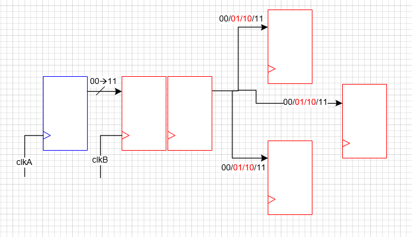
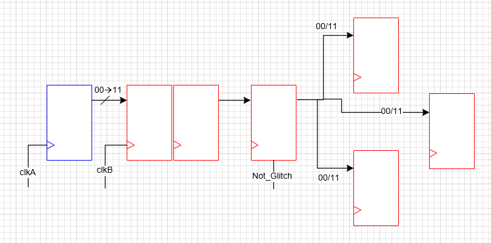
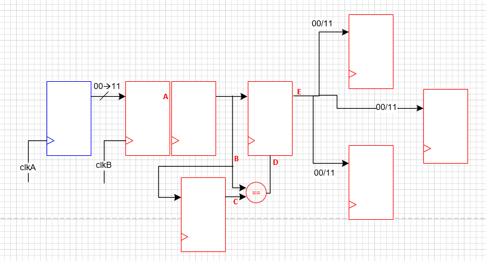
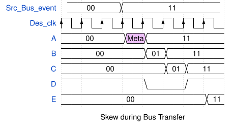
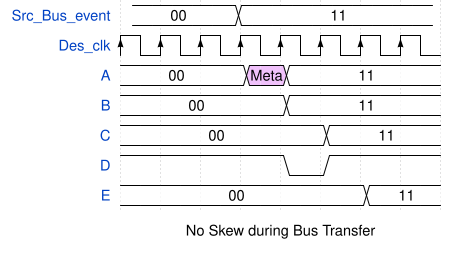

# Bus_sync
## Description
> Classical way to deal with multiple bit CDC crossing involve one-bit load signal. Load signal from clock domain-a will first be sync to domain-b by double FF synchonizer.
> The domain-b signal sync_load will indicate when is the proper time to load multi-bit signal from domain-a to domain-b.
> If load signal is not available, some special technique will have to be adopted to avoid glitch states.
## Why not just 2FF synchonizer for multi-bit signals?
> For multi-bit signal clock domain crossing, not all bits can be sample in one specific clock edge. For example a 2-bit bus signal binary transit from 00->11
> involve all 2 bit transition in one clock edge. Trying to sample this binary signal to another clock domain will be a disaster. Because of bit skew, random condions from 00,01,10,11
> are all possible outcomes. Even though we can deal with metastable using 2FF synchonizer, glitch states will have to be dealt using other techniques. 

## Data Load
> One idea is to create a load signal indicating this is not a Glitch state, data is stable.

> Another Flip-Flops stage can be used, then compare the 2nd and the 3rd stage are equal or not.
> In most of cases, Glitch state can't last longer than 1T, if it does, cascade 4th stage and so on.

## Timing Diagram of Bus-sync without additional dataload

